# Biblioteca IPF

App integradora del Taller Complementario React Native II (Instituto Politécnico Formosa, TP N° 4). Sirve para consultar el catálogo de la biblioteca, buscar y escanear libros, reservarlos (préstamo a 7 días o lista de espera), recibir un recordatorio de devolución y, para el personal, entregar los libros respetando el orden de las reservas.

- **Expo SDK 58** (`expo@~58.0.26`), React Native 0.88.1, React 19.3, Expo Router `~58.0.32`, TypeScript 6.
- Módulos nativos: solo `expo-camera` y `expo-notifications`. La app no pide ningún otro permiso.
- Opcionales hechos: persistencia (AsyncStorage), tests con `jest-expo`, debounce en el buscador y modo oscuro.

## Cómo ejecutar

Requisitos: Node 20 o posterior (probado con Node 24) y la app **Expo Go** (compatible con SDK 58) en el teléfono, conectado a la misma red Wi-Fi que la computadora.

```bash
npm install
npx expo start        # escaneá el QR con Expo Go (Android) o con la cámara (iOS)
```

| Tarea | Comando |
| --- | --- |
| Servidor de desarrollo | `npx expo start` (o `npm start`) |
| Lint | `npx expo lint` (o `npm run lint`) |
| Tipos | `npx tsc --noEmit` (o `npm run typecheck`) |
| Tests | `npm test` |
| Diagnóstico | `npx expo-doctor` |

> Las rutas tipadas se generan en `.expo/types/router.d.ts` al correr `npx expo start` (la carpeta `.expo` no se sube al repo). Después de clonar, corré `npx expo start` una vez antes de `npx tsc --noEmit` para que el chequeo de `href` sea estricto.

### Credenciales del personal (para probar `/login` y `/mostrador`)

| Usuario | Clave |
| --- | --- |
| `biblioteca` | `ipf2026` |

Están en [src/constants/biblioteca.ts](src/constants/biblioteca.ts) (la consigna pide usuario y clave fijos en el código).

## Rutas y navegadores

### Árbol de `src/app`

```
src/app/
├── _layout.tsx               → Stack RAÍZ. Monta el Provider del Context, el ThemeProvider,
│                               Stack.Protected (login / mostrador) y unstable_settings.anchor = '(tabs)'.
├── (tabs)/
│   ├── _layout.tsx           → TABS (expo-router/js-tabs): "Catálogo" y "Mis reservas", íconos Ionicons.
│   ├── (catalogo)/
│   │   ├── _layout.tsx       → STACK de la tab Catálogo (anchor = 'index', header con link "Personal").
│   │   ├── index.tsx         → /
│   │   └── libro/
│   │       └── [isbn].tsx    → /libro/[isbn]
│   └── reservas.tsx          → /reservas
├── buscar.tsx                → /buscar?q=           (Stack raíz)
├── escanear.tsx              → /escanear            (Stack raíz)
├── reservar/
│   └── [isbn].tsx            → /reservar/[isbn]     (Stack raíz, presentation: "modal")
├── permisos/
│   └── [recurso].tsx         → /permisos/[recurso]  (Stack raíz, presentation: "modal"; camara | notificaciones)
├── login.tsx                 → /login               (modal; solo existe SIN sesión: Stack.Protected guard={!sesion})
├── mostrador.tsx             → /mostrador           (solo existe CON sesión: Stack.Protected guard={sesion})
├── reserva.tsx               → /reserva             (<Redirect href="/reservas" />, URL vieja)
└── +not-found.tsx            → cualquier otra URL   (muestra usePathname() y un <Link> al Catálogo)
```

Los grupos `(tabs)` y `(catalogo)` no agregan segmentos a la URL: `/` y `/libro/[isbn]` viven dentro de la pestaña Catálogo.

### Árbol general de `src`

```
src/
├── app/          solo rutas (pantallas y _layout.tsx)
├── components/   componentes reutilizables, uno por archivo (FilaLibro, EstadoCarga, MensajeError,
│                 BotonPrimario, BotonIcono, TarjetaPrestamo, ListaRecientes, PantallaPermisoBloqueado…)
├── hooks/        useLibros, usePermiso, useTema, useTemaNavegacion
├── lib/          lógica sin UI: api.ts (entregado por la cátedra), validaciones, fechas, prestamos
│                 (disponibles calculados), permisos (mapeo a 4 estados), notificaciones, persistencia,
│                 catalogo (búsqueda local por ISBN), recientes, navegacion
├── data/         libros.ts (19 libros) y esperaInicial.ts (lista de espera inicial)
├── types/        index.ts (Libro tal cual la consigna + tipos del dominio y del Context)
├── context/      BibliotecaContext.tsx (estado global, Provider y useBiblioteca)
├── estructuras/  Pila.ts y Cola.ts (+ __tests__)
└── constants/    tema.ts (colores claro/oscuro, espaciado, tipografía, radios, 44 px táctiles),
                  biblioteca.ts (usuario actual, días de préstamo, credenciales…), textos.ts
```

Dirección de las importaciones: `app → components → hooks → context → lib → data/estructuras/types/constants`. Nada importa desde `src/app`.

## `app.json`: bloque `plugins` comentado

JSON no admite comentarios, así que acá va el mismo bloque anotado:

```jsonc
"plugins": [
  // Expo Router: rutas basadas en archivos dentro de src/app.
  "expo-router",
  [
    "expo-splash-screen",
    {
      "backgroundColor": "#F6F1E7",              // fondo "papel" del tema claro
      "image": "./assets/images/splash-icon.png",
      "imageWidth": 76,
      "dark": {                                  // splash del modo oscuro
        "backgroundColor": "#121815",
        "image": "./assets/images/splash-icon.png"
      }
    }
  ],
  [
    "expo-camera",
    {
      // Texto de propósito (iOS: NSCameraUsageDescription). Molde "Usamos tu [dato] para [beneficio]".
      "cameraPermission": "Usamos tu cámara para leer el código de barras del libro y abrir su ficha sin escribir el ISBN.",
      // Mínimo privilegio: la app no graba video con sonido.
      "microphonePermission": false,   // iOS: no agrega NSMicrophoneUsageDescription
      "recordAudioAndroid": false,     // Android: no agrega RECORD_AUDIO
      "barcodeScannerEnabled": true    // necesario para leer EAN-13
    }
  ],
  [
    "expo-notifications",
    {
      "color": "#1F5C4A",                         // color primario del tema para el ícono de la notificación (Android)
      "defaultChannel": "prestamos",              // canal por defecto (el mismo que crea la app)
      "enableRemoteNotifications": false,         // solo notificaciones locales: sin entitlement aps-environment en iOS
      "enableBackgroundRemoteNotifications": false
    }
  ]
]
```

Otras claves: `"scheme": "bibliotecaipf"`, `"userInterfaceStyle": "automatic"` (modo oscuro), `"experiments": { "typedRoutes": true }` (rutas tipadas) y `"reactCompiler": true` (viene con la plantilla de SDK 58).

## Permisos

| Recurso | Módulo | Cuándo se pide | Alternativa si se deniega |
| --- | --- | --- | --- |
| Cámara | `expo-camera` (`useCameraPermissions`, dentro de `usePermiso`) | Al tocar **"Activar la cámara"** en `/escanear` se abre la pantalla previa `/permisos/camara`; recién ahí "Continuar" muestra el diálogo del sistema. | Campo para escribir el ISBN a mano (siempre visible en `/escanear`). Si está bloqueado: mensaje y botón "Abrir Ajustes". |
| Notificaciones | `expo-notifications` (`getPermissionsAsync` / `requestPermissionsAsync`, dentro de `usePermiso`) | Únicamente al activar el interruptor **"Recordarme"** de un préstamo en `/reservas` (pasa por `/permisos/notificaciones?isbn=…`). Nunca al abrir la app. En Android se crea antes el canal `prestamos`. | Avisos dentro de la app en `/reservas` ("Las notificaciones están desactivadas. Te avisamos acá adentro.") y botón "Abrir Ajustes". El interruptor queda apagado. |

### Permisos Android resultantes

Verificado con `npx expo prebuild --platform android --no-install` (la carpeta `android/` generada se borró, no se sube):

- Declarados por la app: `CAMERA` (plugin de `expo-camera`), `INTERNET` y `VIBRATE` (plantilla de Expo: conexión con Metro en desarrollo y vibración de las notificaciones).
- Agregados por las librerías al fusionar el manifiesto: `POST_NOTIFICATIONS` y `RECEIVE_BOOT_COMPLETED` (`expo-notifications`: pedir permiso en Android 13+ y reprogramar recordatorios después de reiniciar).

### Justificación de `android.blockedPermissions`

Cada permiso bloqueado se marca con `tools:node="remove"` en el manifiesto, así ninguna dependencia lo puede volver a agregar:

| Permiso bloqueado | Por qué |
| --- | --- |
| `RECORD_AUDIO` | La cámara solo lee códigos de barras; no se graba video con sonido. Además de `recordAudioAndroid: false`, se bloquea por si otra dependencia lo agrega. |
| `ACCESS_FINE_LOCATION` | La app no usa la ubicación precisa para nada. |
| `ACCESS_COARSE_LOCATION` | Tampoco la ubicación aproximada. |
| `READ_MEDIA_IMAGES` | No se eligen fotos de la galería (Android 13+). |
| `READ_MEDIA_VIDEO` | No se leen videos del dispositivo (Android 13+). |
| `READ_EXTERNAL_STORAGE` | Lo declara `expo-file-system` (dependencia de `expo`); la app no lee archivos del almacenamiento compartido. |
| `WRITE_EXTERNAL_STORAGE` | Lo declara `expo-file-system`; la app no escribe en el almacenamiento compartido (los datos van a AsyncStorage, privado de la app). |
| `SYSTEM_ALERT_WINDOW` | La app no dibuja ventanas sobre otras apps. |

En iOS, `npx expo config --type introspect` muestra solo `NSCameraUsageDescription` con el texto de arriba y ningún entitlement (no hay `aps-environment` porque `enableRemoteNotifications` es `false`).

## Deep links de prueba

| Link | Qué debería pasar |
| --- | --- |
| `bibliotecaipf://libro/9788499089515` | Detalle de *Ficciones*, con el Catálogo debajo en la pestaña. |
| `bibliotecaipf://libro/123` | "El código “123” no es un ISBN válido…" + link al Catálogo (no se hace ningún pedido). |
| `bibliotecaipf://buscar?q=borges` | Buscador con los 4 libros de Borges; las pestañas quedan debajo (anchor). |
| `bibliotecaipf://mostrador` | Sin sesión, la ruta no existe (Stack.Protected) y se muestra el Catálogo. |
| `bibliotecaipf://reserva` | Redirige a `/reservas`. |
| `bibliotecaipf://escanear` | Escáner en el estado de permiso que corresponda; siempre con ingreso manual. |

En **Expo Go** el esquema propio no está registrado: se usa la URL del servidor de desarrollo con `/--/` (reemplazá la IP por la que muestra `npx expo start`):

```bash
# Android (con el teléfono por USB o un emulador)
adb shell am start -a android.intent.action.VIEW -d "exp://192.168.0.10:8081/--/buscar?q=borges"
adb shell am start -a android.intent.action.VIEW -d "exp://192.168.0.10:8081/--/libro/9788499089515"

# Alternativa multiplataforma
npx uri-scheme open "exp://192.168.0.10:8081/--/libro/123" --android
npx uri-scheme open "exp://192.168.0.10:8081/--/mostrador" --ios

# Con un development build (esquema propio registrado)
npx uri-scheme open "bibliotecaipf://reserva" --android
```

## Decisiones técnicas

- **Import de Tabs**: `import { Tabs } from 'expo-router/js-tabs'`. En SDK 58 el `Tabs` exportado desde `expo-router` está marcado `@deprecated` ("Use `import { Tabs } from 'expo-router/js-tabs'` instead", ver `node_modules/expo-router/build/exports.d.ts`). La plantilla trae `NativeTabs` (`expo-router/native-tabs`), pero la consigna pide íconos de `@expo/vector-icons` y un Stack propio dentro de la pestaña; con las Tabs JS eso es directo (`tabBarIcon` con `Ionicons`) y además se ve igual en Android, iOS y web.
- **Navegación al confirmar la reserva**: `router.dismissTo('/reservas')`. Cierra el modal y navega hasta `/reservas` sin dejar la confirmación en el historial: "atrás" no vuelve a confirmar. Con `push` la confirmación quedaría debajo (atrás la mostraría otra vez, permitiendo un doble intento). Con `replace` se reemplaza solo la pantalla actual (el modal): no "cierra" el modal sino que lo cambia por otra ruta, y la animación es la de abrir una pantalla nueva. `dismissTo` expresa exactamente lo que se quiere: cerrar hasta llegar a `/reservas` (si no la encuentra en la pila, reemplaza).
- **Cerrojo del escáner con `useRef`**: `onBarcodeScanned` llega muchas veces por segundo. Un `useState` en `true` recién se ve en el próximo render, y las llamadas que ya están en cola usan la clausura vieja (con `false`): navegarían varias veces. `ref.current = true` cambia en el momento. Al leer un ISBN del catálogo se usa `router.replace` para que "atrás" desde el detalle no vuelva al escáner.
- **Pila y Cola sin mutar el estado**: el Context nunca llama `encolar`/`apilar` sobre la instancia guardada. Clona (`cola.clonar()` / `Cola.desde(arr)`), opera sobre la copia y hace `setX(prev => …)` con la instancia nueva. Así React ve una referencia distinta y re-renderiza. Se eligió `useState` con actualizaciones funcionales (y no `useReducer`) porque varias acciones son async (programar y cancelar notificaciones) y quedan más claras escritas directo en cada `useCallback`.
- **Disponibles calculados**: `calcularDisponibles(libro, prestamos)` en [src/lib/prestamos.ts](src/lib/prestamos.ts) = `max(0, ejemplares − préstamos activos de origen 'estante' + préstamos de origen 'mostrador' ya devueltos)`. No se guarda un contador aparte: si el mismo dato viviera en dos lugares (contador y lista de préstamos) se desincronizaría al primer olvido. Un préstamo del mostrador usa un ejemplar que devolvió otra persona; cuando vos lo devolvés, vuelve al estante (por eso suma).
- **Buscador**: la consulta vive en la URL (`router.setParams`, no apila pantallas). El efecto depende de `q`, espera 300 ms (debounce) y su limpieza hace `clearTimeout` y `activo = false`: solo la última búsqueda puede escribir resultados aunque las respuestas lleguen desordenadas.
- **Regla `react-hooks/set-state-in-effect`**: `eslint-config-expo` de SDK 58 trae las reglas del React Compiler y prohíbe `setState` sincrónico dentro de un efecto. Por eso `cargando = true` se pone en los handlers (`reintentar`, `cambiarTexto`) y en el estado inicial; los efectos solo hacen `setState` después del `await`.
- **`<Link asChild>`**: los componentes envueltos en `Link` usan `style` estático; la forma `style={({ pressed }) => …}` se pierde al pasar por el `Slot` del Link (se detectó probando en web).

## Verificación

Salida real al cerrar el trabajo:

```text
$ npx tsc --noEmit
(sin salida, código de salida 0)

$ npx expo lint
(sin salida, código de salida 0: 0 errores, 0 warnings, sin reglas desactivadas)

$ npm test
> biblioteca-ipf@1.0.0 test
> jest
Test Suites: 3 passed, 3 total
Tests:       23 passed, 23 total
Snapshots:   0 total
Ran all test suites.

$ npx expo-doctor
Running 20 checks on your project...
20/20 checks passed. No issues detected!

$ npx expo export --platform android --output-dir <carpeta temporal>
› android bundles (1):
_expo/static/js/android/entry-….hbc (2.8MB)
```

Los tests están en [src/estructuras/\_\_tests\_\_](src/estructuras/__tests__) (Pila y Cola: cola vacía, FIFO/LIFO, `tamanio`, copia en `aArray`, `posicionDe`, `desde`/`clonar`) y [src/lib/\_\_tests\_\_](src/lib/__tests__) (ISBN, mapeo de permisos, disponibles, recientes, validación del estado guardado).

## Capturas

Tomadas en un teléfono Android real con Expo Go (SDK 58). Están en [docs/capturas](docs/capturas).

### Catálogo

| Con datos | Con error |
| --- | --- |
| 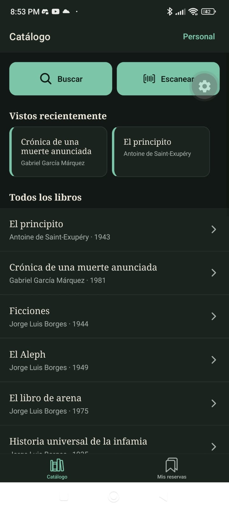 | 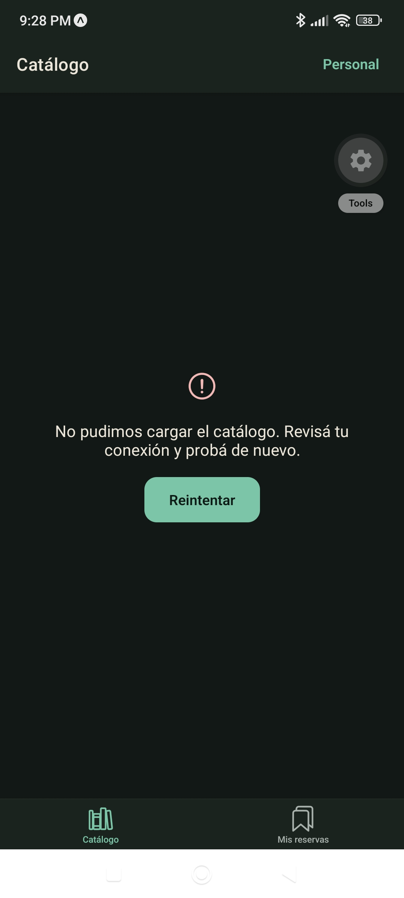 |

### Detalle

| Libro | Cargando | Error al cargar |
| --- | --- | --- |
| 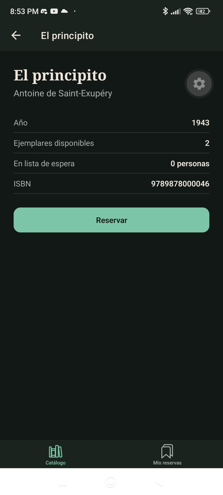 | 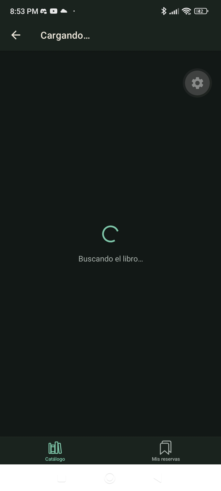 | 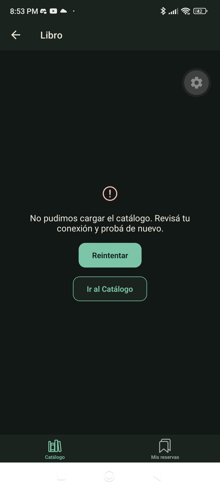 |

### Buscador

| Resultados (`borges`) | Buscando | Sin resultados |
| --- | --- | --- |
|  | 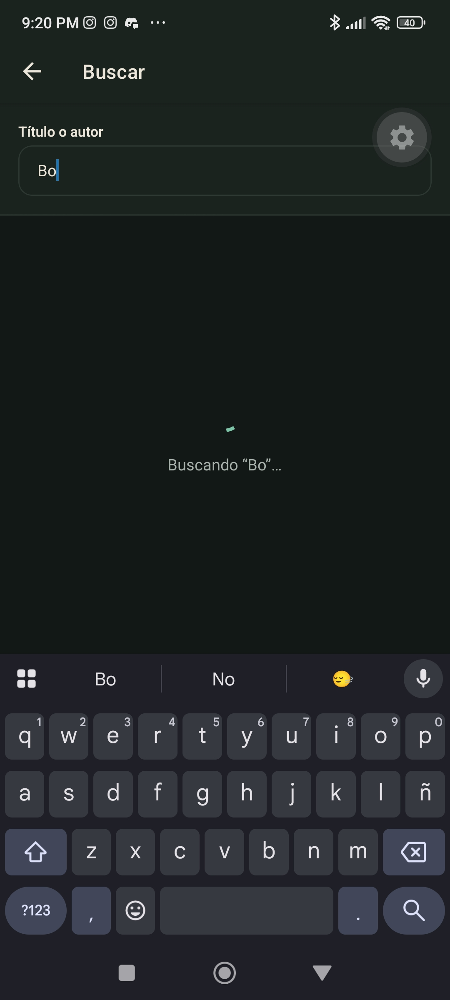 |  |

### Reservas

| Con ejemplares (préstamo) | Sin ejemplares (lista de espera) |
| --- | --- |
| 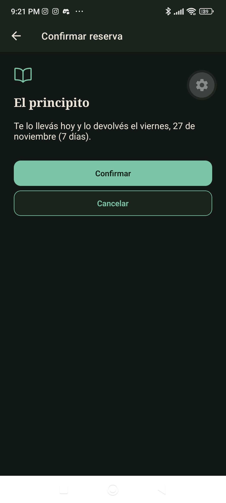 | 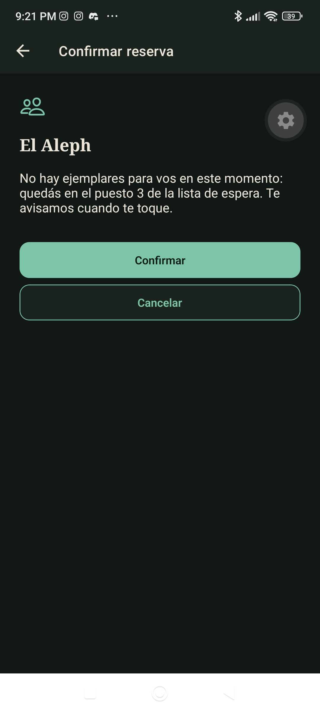 |

| Mis reservas: préstamo | Préstamo y espera | Notificaciones activadas |
| --- | --- | --- |
| 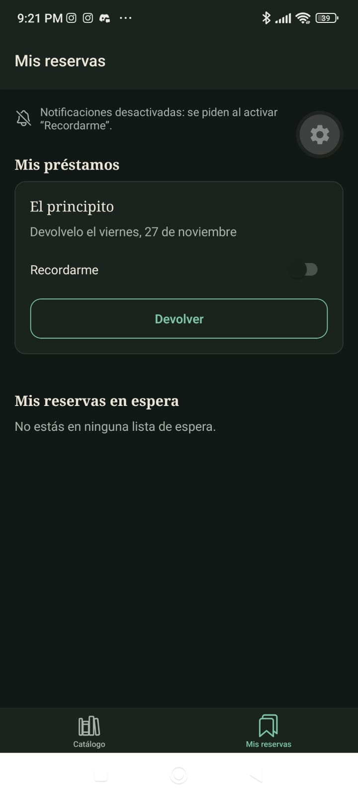 | 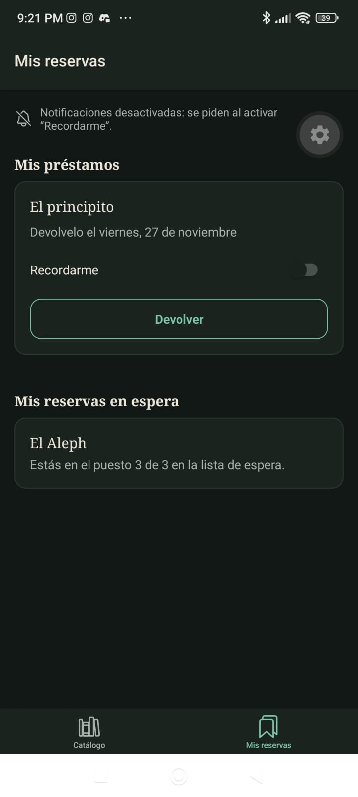 | 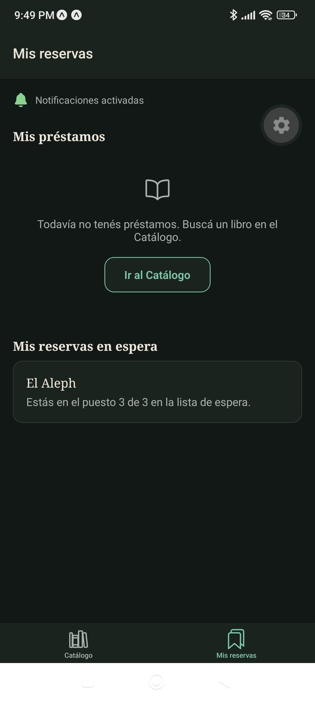 |

### Escáner (permiso de cámara)

| Preguntable | Pantalla previa | Diálogo del sistema (Expo Go) |
| --- | --- | --- |
| 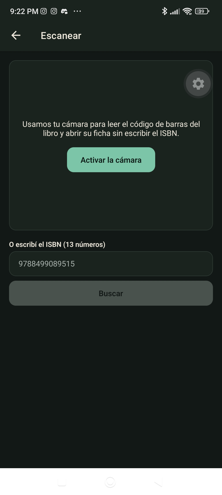 | 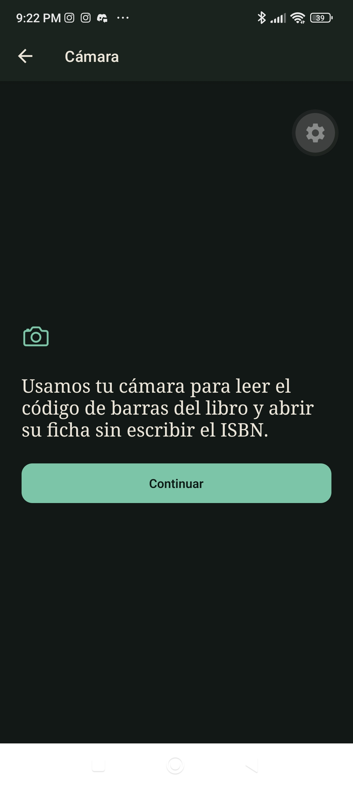 | 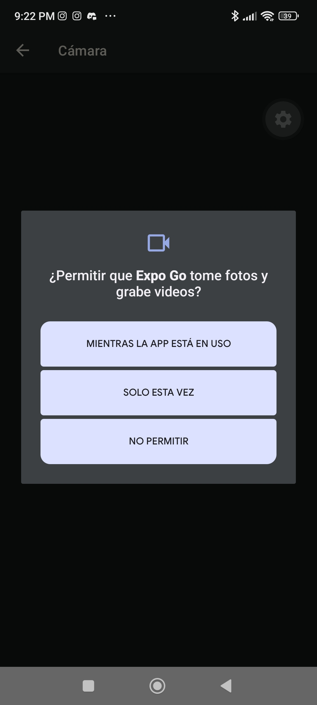 |

| Concedido | Bloqueado |
| --- | --- |
| 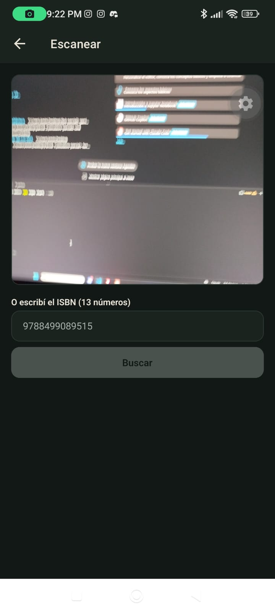 | 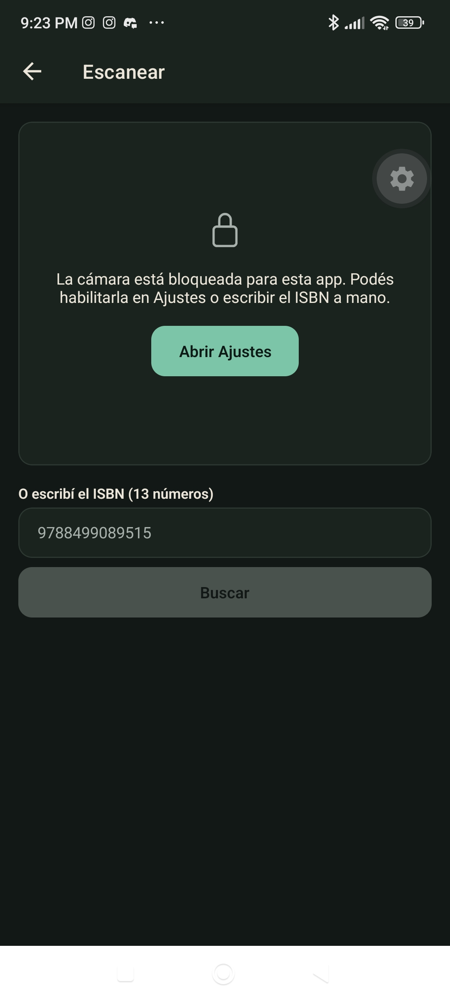 |

### Notificaciones

| Pantalla previa | Diálogo de Expo Go | Notificación recibida | En la pantalla de bloqueo |
| --- | --- | --- | --- |
| 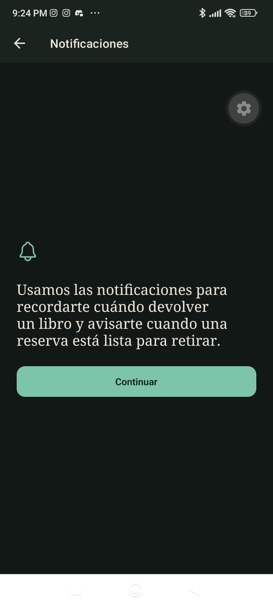 | 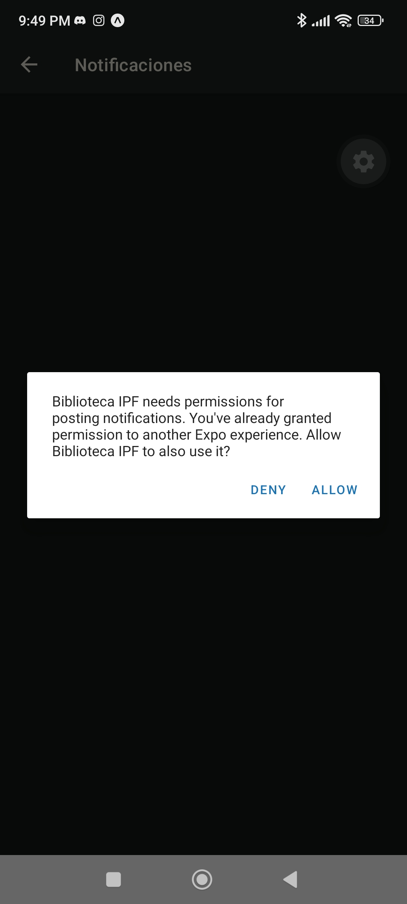 | 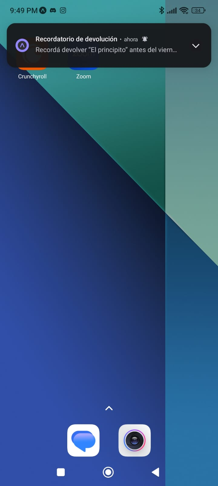 | 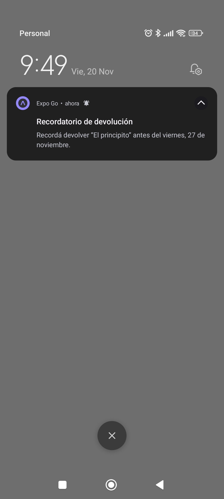 |

En Expo Go el diálogo del sistema muestra el texto de Expo Go, no el texto de propósito de `app.json` (ver la sección "Development build").

### Otras

| Pantalla 404 (`/calquiercosa`) |
| --- |
|  |

### Pendientes

- Catálogo cargando
- Detalle inexistente (`/libro/abc` o un ISBN que no existe)
- Escáner: cargando
- Mostrador antes y después de "Entregar al siguiente"
- (Opcional) Diálogo de cámara en development build

## Development build (opcional)

Para ver el diálogo de cámara con el texto de propósito propio (en Expo Go se ve el texto de Expo Go):

```bash
npm install -g eas-cli          # o usá npx eas-cli@latest en cada comando
eas login
eas build:configure             # crea eas.json
npx expo install expo-dev-client
eas build --profile development --platform android
# Instalá el .apk que te da EAS en el teléfono y después:
npx expo start --dev-client
```

En el development build el esquema `bibliotecaipf://` queda registrado, así que los deep links funcionan con el esquema propio.

## Datos de prueba

- 19 libros reales en [src/data/libros.ts](src/data/libros.ts), con ISBN-13 de dígito verificador válido. Los dos primeros están marcados `// TODO-ALUMNO` para reemplazarlos por libros propios y probar el escáner.
- Sin ejemplares: *El Aleph*, *Rayuela*, *Sobre héroes y tumbas* y *Las cosas que perdimos en el fuego*. Con lista de espera inicial ([src/data/esperaInicial.ts](src/data/esperaInicial.ts)): *El Aleph* (2 personas), *Rayuela* (1) y *Las cosas que perdimos en el fuego* (2).
- Recordatorio en modo demostración: llega a los 15 segundos (`SEGUNDOS_RECORDATORIO_DEMO`).
